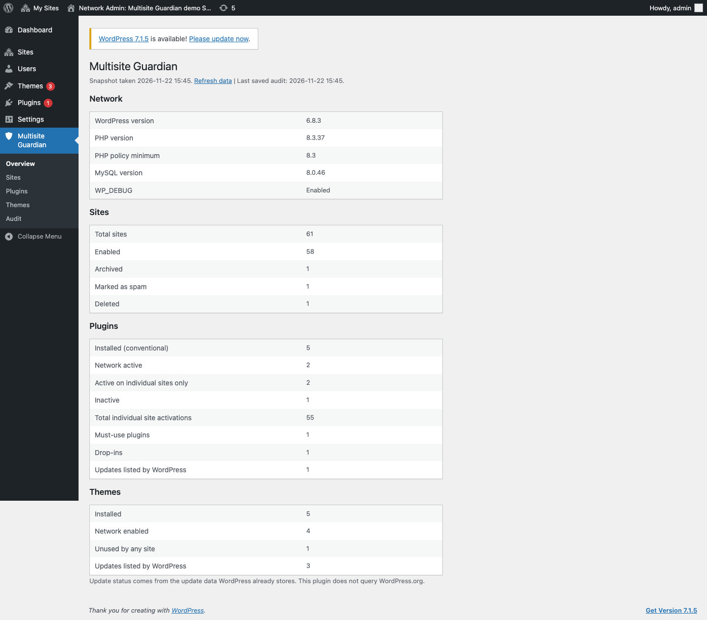
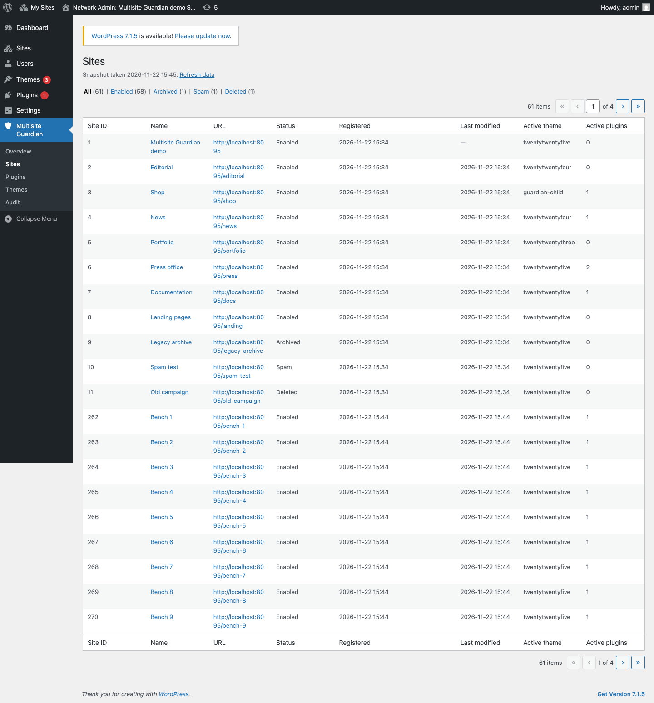
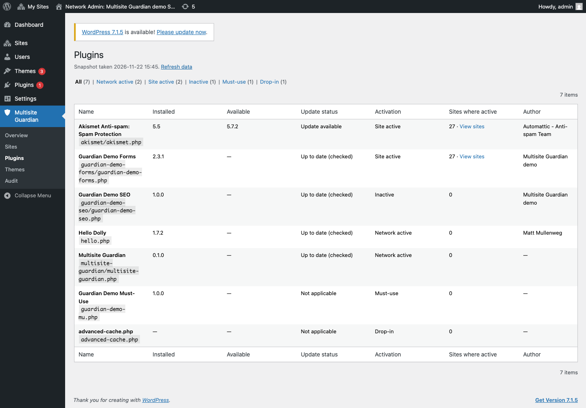
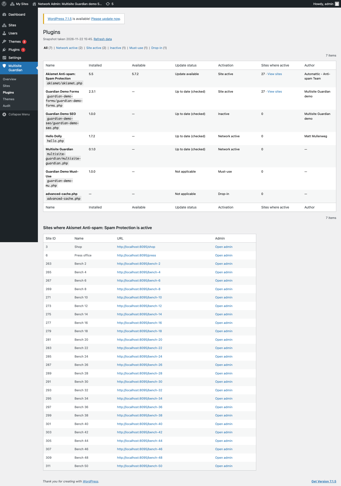
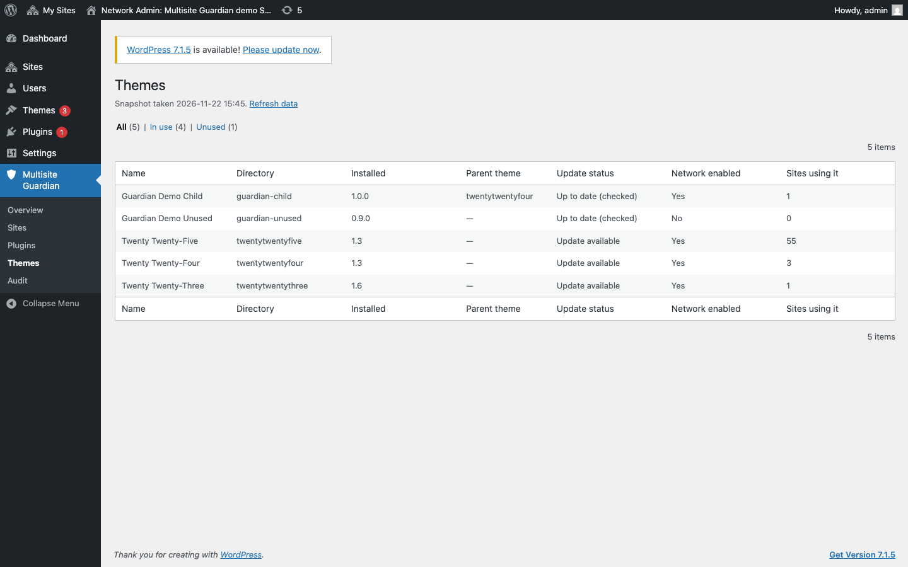
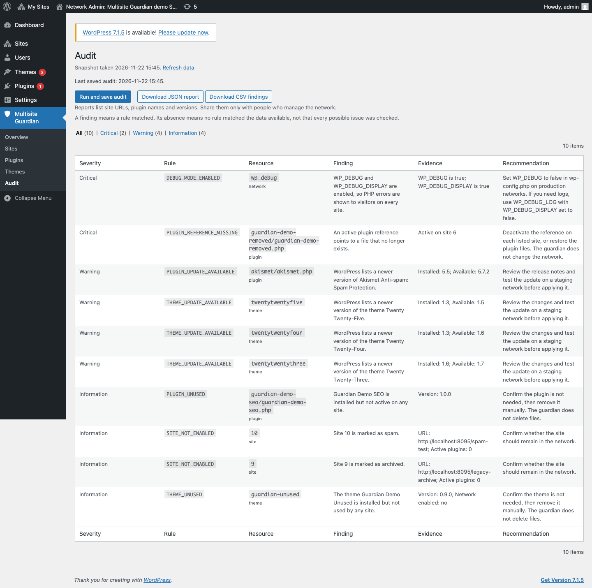
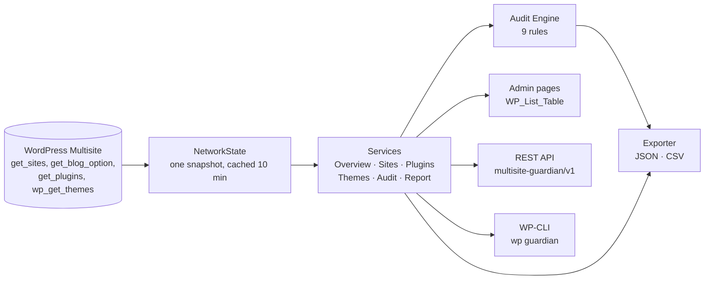

# Multisite Guardian

Network-wide inventory, audit and diagnostics for WordPress Multisite.

Agencies and publishers that run dozens of sites on one Multisite install usually answer basic questions by opening each site's admin: which plugins are active where, which themes nobody uses, which sites are archived, which PHP version the network runs. Multisite Guardian answers those questions once, for the whole network, from the Network Admin.

It is read-only. It does not update, activate, deactivate, or delete anything. Every finding tells you what it saw and what to check next.

> **Status:** v0.1.0 MVP. Tested on WordPress 6.8 with PHP 8.3 and MySQL 8.0. See [Limitations](#limitations).

## Features

- **Network overview:** site counts by status, plugin and theme totals, activation scope, pending updates, and the WordPress, PHP and MySQL versions. Network-level and site-level figures are kept apart.
- **Sites:** ID, name, URL, status, registration and last-modified dates, active theme, and active plugin count. Search, status views, pagination, and a link to each site's admin.
- **Plugins:** installed, network-active, site-active, inactive, must-use and drop-in entries. Each plugin shows the sites where it is active individually.
- **Themes:** installed themes, parents, network enablement, sites that use each theme, and themes no site uses. A parent counts as in use while a child theme on any site uses it.
- **Audit:** nine deterministic rules. Each finding has a rule ID, severity, resource, evidence, and a recommendation.
- **Reports:** a consolidated JSON report and a CSV export of the findings, from the Audit page or WP-CLI.
- **REST API** under `multisite-guardian/v1`, using the same services as the dashboard.
- **WP-CLI** under `wp guardian`, with table, JSON and CSV output and an exit code for CI gates.

## Screenshots

Captured from the local demo network with `python3 scripts/capture-screenshots.py`. The demo contains test data only.

| | |
| --- | --- |
|  |  |
|  |  |
|  |  |

## Requirements

- WordPress Multisite, 6.5 or later. The test suite runs on 6.8 only.
- PHP 8.3 or later.
- MySQL 8.0 or MariaDB 10.11 (both tested).

## Installation

1. Build the ZIP or download a release:

   ```sh
   sh scripts/build-release.sh   # writes dist/multisite-guardian-<version>.zip
   ```

2. In the Network Admin, go to **Plugins → Add New → Upload Plugin**, upload the ZIP and choose **Network Activate**. The plugin does not run on single sites.
3. Open **Multisite Guardian** in the Network Admin menu.

The plugin has no runtime dependencies. It does not need Composer or `vendor/` at runtime.

To check the ZIP on a fresh network, with its own database and containers, run:

```sh
sh scripts/verify-clean-install.sh dist/multisite-guardian-0.1.0.zip
```

## Local demo environment

The Docker environment builds a demo network with ten sites, several themes, a child theme, plugins activated in different combinations, one archived site, one spam site, one deleted site, a must-use plugin, a drop-in, and a reference to a plugin file that does not exist. It needs no external services, apart from the image pulls and the WordPress.org update checks that WordPress itself runs.

```sh
docker compose up -d
docker compose run --rm wpcli sh /scripts/bootstrap-network.sh
```

Then open <http://localhost:8095/wp-admin/network/> and log in as `admin` with the password `guardian-local-only`. Set `GUARDIAN_ADMIN_PASSWORD` to choose a different password before running the bootstrap.

The bootstrap script is safe to run again. Other demo accounts it creates:

- `newsadmin` (password: the same). An administrator of one site, not a network administrator. Use it to confirm that per-site administrators cannot reach network data.

The integration suite needs a `wordpress_test` database. The compose file creates it when the MySQL volume is first initialized. On an existing volume, create it once:

```sh
docker compose exec db mysql -uroot -proot --ssl-mode=DISABLED \
  -e "CREATE DATABASE IF NOT EXISTS wordpress_test; GRANT ALL PRIVILEGES ON wordpress_test.* TO 'wordpress'@'%';"
```

### Checks

```sh
sh scripts/smoke-test.sh                  # CLI output, exit codes and export format against the demo network
docker compose --profile tests run --rm tests   # WordPress integration suite in Multisite mode
sh scripts/benchmark-network.sh 50        # creates, measures and removes a synthetic network
python3 scripts/capture-screenshots.py    # refreshes docs/screenshots from the demo network
```

## WP-CLI

```sh
wp guardian overview --format=json
wp guardian sites --status=archived
wp guardian plugins --scope=site_active
wp guardian plugins --plugin=akismet/akismet.php          # sites where one plugin is active
wp guardian themes --status=unused --format=csv
wp guardian audit --severity=warning
wp guardian audit --fail-on=critical                      # exits 1 when a critical finding exists
wp guardian report --format=json > guardian-report.json
wp guardian report --format=csv > guardian-findings.csv
```

Every command runs against fresh data. Output formats: `table` (default), `json` and `csv` for list commands. `report` supports `json` and `csv`.

WP-CLI commands run with the privileges of the shell that runs them, so they are trusted in the same way as `wp-config.php`. Run them only from accounts that already control the server.

## REST API

Base URL: `/wp-json/multisite-guardian/v1`. All routes need an authenticated user and return `401` otherwise.

| Route | Capability | Notes |
| --- | --- | --- |
| `GET /overview` | `manage_network` | Totals for sites, plugins, themes, and the environment. |
| `GET /sites` | `manage_sites` | `status`, `search`, `page`, `per_page` (1–100, default 20). |
| `GET /sites/{id}` | `manage_sites` | `404` when the site does not exist. |
| `GET /plugins` | `manage_network_plugins` | `scope`, `search`, `page`, `per_page`. |
| `GET /themes` | `manage_network_themes` | `status` (`in_use` or `unused`), `search`, `page`, `per_page`. |
| `GET /audit` | `manage_network` | `severity`, `page`, `per_page`. |

Collections return `X-WP-Total` and `X-WP-TotalPages` headers. Invalid parameters return `400` with the WordPress `rest_invalid_param` error.

Data comes from a snapshot cached for ten minutes. Use WP-CLI when you need a fresh read.

## Audit rules

| Rule | Severity | What it checks |
| --- | --- | --- |
| `PLUGIN_UPDATE_AVAILABLE` | Warning | WordPress lists a newer version of a conventional plugin. |
| `THEME_UPDATE_AVAILABLE` | Warning | WordPress lists a newer version of a theme. |
| `UPDATE_DATA_STALE` | Information | Update data is missing, or last checked more than two days ago. |
| `PLUGIN_UNUSED` | Information | A conventional plugin is inactive network-wide and on every site. |
| `THEME_UNUSED` | Information | No site uses the theme, directly or as a parent. |
| `SITE_NOT_ENABLED` | Information | A site is archived or marked as spam. |
| `PLUGIN_REFERENCE_MISSING` | **Critical** | An active plugin reference points to a file that no longer exists. |
| `DEBUG_MODE_ENABLED` | Warning, or **Critical** | `WP_DEBUG` is on. Critical when `WP_DEBUG_DISPLAY` also shows errors to visitors. |
| `PHP_BELOW_MINIMUM` | **Critical** | PHP is below the policy minimum (8.3 by default). |

Critical is used only where the condition is objective: a missing file, a version below a documented policy, or errors displayed to visitors.

A finding means a rule matched. No finding means no rule matched the data that was available. It does not mean every possible issue was checked.

Update rules report what WordPress reports. They do not query a vulnerability database, so an outdated plugin is never described as vulnerable.

## Security model

- **Capabilities.** Every REST route and admin page checks a network capability. A site administrator without network rights gets `403` on every route and no Network Admin menu entries. The integration suite and an HTTP check both verify this.
- **Nonces.** Running an audit and downloading reports use nonces and capability checks. The refresh link needs a valid nonce, and an invalid one is ignored.
- **Output.** All values are escaped on output. CSV cells are quoted, and cells that start with `=`, `+`, `-`, `@`, tab or carriage return are prefixed with an apostrophe so spreadsheets do not run them as formulas.
- **Data minimization.** Reports contain no user accounts, email addresses or credentials. Site administrator emails are never read.
- **No mutations.** Audits and inventories only read. The plugin never writes to plugins, themes, options or sites, except its own last-audit record and cache.
- **No outbound requests.** The plugin makes no HTTP requests. Update data is what WordPress already stores.
- **Rebuild rate limit.** A refresh request returns the cached snapshot when that snapshot is less than a minute old, so repeated clicks cannot force a full network read.
- **Reports are sensitive.** They list site URLs, plugin names and versions, which tells an attacker what to target. The Audit page says so, and the reports are restricted to network administrators.
- **Direct access.** Every PHP file in the plugin exits when loaded outside WordPress.

## Architecture



- `Inventory\NetworkState` is the only code that reads the network. It runs once per request or from the cache.
- `Services` are pure functions over the snapshot: filtering, search, pagination and counts.
- `Audit\Rules` are pure functions over the snapshot. Each one is unit-tested with synthetic data.
- The admin, REST and WP-CLI layers only validate input, check capabilities and call services.

Source layout:

```
multisite-guardian.php      bootstrap and PSR-4-style autoloader
src/Plugin.php              hook registration
src/Inventory/              network snapshot
src/Services/               overview, sites, plugins, themes, audit, report
src/Audit/                  rule contract, engine, finding factory, rules
src/Reports/                JSON and CSV exporter
src/REST/                   routes and permission callbacks
src/CLI/                    WP-CLI commands
src/Admin/                  Network Admin menu, screens, list tables, actions
views/                      admin templates
tests/unit/                 pure tests (no WordPress)
tests/integration/          WordPress PHPUnit suite, Multisite mode
```

## Design decisions and tradeoffs

- **No custom tables.** The MVP stores one record, the last audit, in a network option. Historical snapshots would need a table, `dbDelta`, and schema versioning. That is on the roadmap.
- **One blog switch per site.** Each site's options are read inside a single `switch_to_blog()` call, restored in a `finally` block. An earlier version called `get_blog_option()` once per option, which switched four times per site. A test verifies that building the snapshot leaves `ms_is_switched()` false.
- **One snapshot for every interface.** The dashboard, REST API, CLI, audit and reports share one builder. This avoids duplicate queries and keeps the figures consistent.
- **Ten-minute cache.** Building the snapshot reads options for every site. The cache avoids that on each admin page view. The Refresh link rebuilds, but a rebuild within one minute of the last one returns the cached copy. WP-CLI and reports always rebuild without writing the cache.
- **Audit on demand.** Rules are cheap on a cached snapshot, so the Audit page computes them on view. Saving the run, which updates "last audit", is an explicit action.
- **Matrix replaced by drill-down.** A plugin-by-site matrix does not fit on a screen for large networks. The plugin page lists the sites where each plugin is active individually.
- **Deleted and spam sites are not usage.** A plugin or theme active only on a deleted or spam site counts as unused, and such a site's activations are left out of the totals. Archived sites still count, because they are installed and can be restored.
- **Per-site data never reaches site admins.** There is no per-site page for network data.
- **WordPress file naming.** Classes use PSR-4-style namespaces with WordPress-style file names (`class-sites-table.php`), so the autoloader maps each class name to its file.
- **Hand-written autoloader.** The release ZIP has no runtime dependencies, so the plugin does not need Composer on the production server.
- **Plain arrays between layers.** Snapshots, findings and reports are arrays. They serialize directly to JSON and to transients, with no hydration code.

## Testing

| Suite | Command | What it covers |
| --- | --- | --- |
| Lint | `find . -name '*.php' -not -path './vendor/*' -exec php -l {} \;` | Syntax on PHP 8.3 and 8.4 |
| Standards | `vendor/bin/phpcs` | WordPress Coding Standards |
| Unit | `vendor/bin/phpunit -c phpunit.xml.dist` | Each rule, the engine, services, CSV escaping |
| Integration | `docker compose --profile tests run --rm tests` | Multisite snapshot, cache, REST permissions and validation, report |
| Smoke | `sh scripts/smoke-test.sh` | CLI output and exit codes against the demo network |

CI runs lint on PHP 8.3 and 8.4, the standards check, unit tests and integration tests on PHP 8.3 against MySQL 8.0 with WordPress 6.8. PHP 8.4 is linted only: the test tooling has not been run on it.

Coverage is not measured. The tests focus on business rules, security and failure cases, as the project brief asks.

## Performance

Measured on a synthetic network. Results are from one machine and are not a general claim.

Measured with `scripts/benchmark-network.sh` on Docker Desktop for macOS (arm64), PHP 8.3.37, MySQL 8.0.46, WordPress 6.8.3. Each run is one in-process measurement, taken after the synthetic sites were created and before they were deleted. Runs are noisy on a laptop: the same 50-site build measured 17.8 to 23.7 ms across runs.

| Network | Snapshot build | SQL queries in build | Snapshot size | Audit rules | Peak memory |
| --- | --- | --- | --- | --- | --- |
| 61 sites (11 demo + 50 synthetic) | 23.7 ms | 64 | 31 KB | 17.5 ms, 0 queries | 53 MB |
| 211 sites (11 demo + 200 synthetic) | 163 ms | 216 | 101 KB | 6.4 ms, 0 queries | 57 MB |
| 511 sites (11 demo + 500 synthetic) | 195 ms | 519 | 242 KB | 8.5 ms, 0 queries | 69 MB |

The build costs about one SQL query per site. Going from 61 to 511 sites multiplied the build time by about 8, which is close to linear. A 511-site build takes about 0.2 seconds on this machine. Caching the snapshot keeps that cost off ordinary admin page views. A cache miss pays the full build cost. These numbers come from one machine and one process, and they do not cover a cold request or a busy production database. Measure your own network before relying on them: `sh scripts/benchmark-network.sh <count>`.

## Limitations

- **Scale.** Measured up to 511 sites, where a build took 195 ms and the snapshot was 242 KB. Networks of several thousand sites are untested. Cost grows with the site count, and the whole snapshot sits in one site transient.
- **Update data depends on WordPress.** Statuses reflect the last update check WordPress ran. If cron does not run, statuses become "outdated" or "unknown", and the audit says so.
- **No vulnerability data.** The plugin reports updates, not vulnerabilities.
- **Single network.** It manages the network it is installed in. It does not connect to other installs.
- **CSV contains findings only.** The JSON report has everything. A single CSV file cannot hold several tables.
- **Audit texts are English.** Findings are data for reports and tools, so their text is not translated. Interface labels are translatable.
- **Cache staleness.** REST and admin views can show data up to ten minutes old.
- **Tested on:** WordPress 6.8.3 and 6.5.5 (the declared minimum), PHP 8.3, MySQL 8.0 and MariaDB 10.11. The integration suite passes on all of them.
- **Not tested on:** PHP 8.2 (dropped), PHP 8.4 beyond linting, WordPress releases other than 6.5.5 and 6.8.3, and MySQL versions other than 8.0.
- **Screenshots and demo** are generated from the local demo network, which uses test data.

## Roadmap

- Historical snapshots, with a custom table, `dbDelta`, and trend views.
- A plugin-by-site matrix view for small networks.
- Configurable staleness threshold and PHP policy from the admin UI.
- Translations.

Out of scope, as the brief states: remote installations, mass updates or activation, backups, malware scanning, external vulnerability feeds, notifications, and any SaaS component.

## Contributing

Pull requests need passing lint, standards, unit and integration checks. Keep business logic in `Services` and `Audit`, and keep controllers, screens and commands thin.

## License

GPL-2.0-or-later. See [LICENSE](LICENSE).
